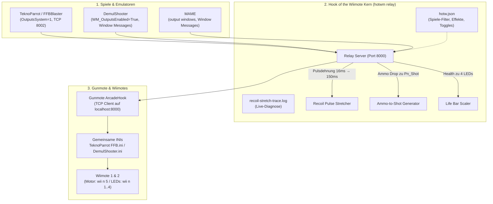

# frieds-hotwm — Hook of the Wiimote 🎯🎮

> **Eigenständiges Haptik- & LED-Relay für Gunmote und Wiimotes (Standalone & Kit-Integration)**

[](LICENSE)
[](https://microsoft.com/windows)
[](https://microsoft.com/powershell)
[](https://python.org)

[English Documentation](README.md) | **Deutsche Dokumentation**

---

## 🎯 Über das Projekt

**Hook of the Wiimote (`hotwm`)** ist ein anfängerfreundliches, transparentes Setup- und Relay-Tool für Arcade-Lightgun-Enthusiasten. Es ermöglicht vollwertiges Haptik-Feedback für Wiimotes hinter **Gunmote**:
- 💥 **Schuss- und Treffer-Rumble:** Intelligente Pulsdehnung (16ms → 150ms), damit der mechanische Vibrationsmotor der Wiimote spürbar anläuft.
- 🚦 **Dynamische Lebensanzeige:** Visualisierung des Spieler-Gesundheitszustands über die 4 Wiimote-Player-LEDs.
- 🔄 **Ammo-Drop zu Schuss:** Automatisches Auslösen von Haptik bei Munitionsverlust (für Spiele ohne explizite Force-Feedback-Events).
- 🕹️ **Multi-Plattform-Support:** Nahtlose Integration mit **TeknoParrot / FFBBlaster**, **DemulShooter** und **MAME**.

Entwickelt sowohl als **tragbares Standalone-Tool** für bestehende RetroBat-, TeknoParrot- und MAME-Setups als auch als nativer Baustein für das [*Fried's Retrogaming Kit*](https://github.com/kburna243/frieds-retrogaming-kit).

---

## 🏗️ Architektur



---

## 🖥️ Standalone-WPF-Dashboard

Das native Windows-Dashboard verwendet Fried's Night/Cream-Farbwelt mit sparsamen grünen, goldenen und roten Statusakzenten. Die Maskottchen-Grafiken liegen lokal bei; Webfonts oder heruntergeladene Grafikressourcen sind nicht erforderlich.

- **Geführte Einrichtung:** Quick-, Custom- und Expert-Modus verwenden dieselbe Sitzung. Wähle einen Ordner, prüfe die lesende Geräteerkennung und halte die gewünschte Bluetooth-MAC-Spielerzuordnung getrennt vom beobachteten Gunmote-Laufzeitplatz des verbundenen Controllers.
- **Manuelle Hardwareprüfungen:** Kopplung, Kalibrierung, Laufzeitplatz-Erkennung sowie Ziel- und Abzugstest erfordern den Nutzer. Ein Windows-PnP-Eintrag belegt weder Kopplung noch Kalibrierung oder Spielfunktion. „Abgeschlossen“ bedeutet, dass du alle erforderlichen Prüfungen bestätigt hast; HOTWM verifiziert die Hardwarefunktion nicht unabhängig.
- **Einzeln geprüfte Aktionen:** Dateiänderungen und Task-Aktionen werden jeweils vorgeschlagen und separat bestätigt. Bei Ablehnung bleibt das Ziel unverändert; es gibt kein „Alles anwenden“ für den gesamten Assistenten.
- **Effektprofile:** Kopiere eine mitgelieferte Vorlage in ein Nutzerprofil und bearbeite unterstützte `hotw.json`-Relaywerte: globale Haltezeit (80–300 ms), Verhalten bei Munitionsverlust, LED-Modus, Trace-Schalter und pro Spiel Rumble-/LED-Schalter. Importierte Profile dürfen zusätzlich `hold_ms` pro Spiel enthalten; das Relay unterstützt diesen Wert und Apply erhält ihn, der Editor bietet dieses Feld jedoch nicht zur direkten Bearbeitung an. Beim Anwenden werden Ziel und Werte gezeigt, eine Sicherung erstellt und unterstützte Änderungen vom laufenden Relay neu geladen.
- **Gunmote-Layouteditor:** Bearbeite tatsächliche OnScreen-/OffScreen-Tastenbelegungen in einer Layout-JSON und füge den Dateinamen optional zu `Keymaps.json` hinzu. Das Speichern erfordert Prüfung und ein geschlossenes Gunmote; ein Layout wird dadurch weder aktiviert noch Gunmote neu gestartet.
- **Button-Intent-Profile:** Dokumentiere semantische Absichten wie Shoot oder Reload. Diese Notizen belegen keine Zuordnung zu einem Controller oder Spiel.
- **Diagnose und Tests:** Lesende Statusabfragen für System, Geräte und Kit; Rumble- und LED-Testknöpfe für Spieler 1/2; Live-Log und Recoil-Tuning. Kit-Diagnosen liefern keinen exakten Dateiänderungsplan für eine Gesamteinrichtung; derzeit gibt es keinen externen Agenten, der den HOTWM-Snapshot-Vertrag nutzt.

Start mit `Start-HotwmDashboard.bat` oder `./gui/HotwmDashboard.ps1`.

---

## 🛠️ Schnellstart & Installation

### Voraussetzungen
1. **Windows 10 oder 11 (64-Bit)**
2. **Python 3.10+** (im System-PATH vorhanden)
3. **Gunmote** mit geladener ArcadeHook-DLL
4. **Bluetooth** (integriert oder DolphinBar) mit gekoppelten Wiimotes

### Installation als Hintergrund-Dienst
Um das Relay automatisch beim Windows-Login zu starten:
```powershell
.\tools\Install-HotwmTask.ps1
```
Zum Entfernen:
```powershell
.\tools\Uninstall-HotwmTask.ps1
```

### Standalone-Paket bauen
Um ein portables Distributions-ZIP zu erstellen:
```powershell
.\tools\Build-HotwmPackage.ps1
```
Das fertige Paket liegt anschließend unter `dist/frieds-hotwm-v<version>.zip`.

---

## ⚙️ Konfiguration (`config/hotw.json`)

```json
{
  "global": {
    "hold_ms": 150,
    "ammo_drop_shot": true,
    "led_mode": "life_bar",
    "trace_enabled": false
  },
  "games": {
    "Rambo": { "rumble": true, "leds": true },
    "2spicy": { "rumble": true, "leds": true },
    "hotd4": { "rumble": true, "leds": true },
    "la_machineguns": { "rumble": true, "leds": false }
  }
}
```

---

## 🚀 Meilensteine & Status

Das ursprüngliche Relay, die Konfigurations-Engine, Windows-Task-Tools, das Dashboard-Grundgerüst und das portable Paket (Phasen 1–5) sind abgeschlossen. Diese historischen Meilensteine bedeuten nicht, dass die neuere Einrichtungs-Orchestrierung fertig ist.

**Aktuelle Arbeit — geführte Einrichtung und Kit-Orchestrierung:** Das Dashboard bietet drei Einrichtungsmodi, lesende Geräteinformationen, manuelle Prüfvermerke und einzeln geprüfte lokale Änderungen. Ein sicheres Kit-Gesamtverfahren ist weiterhin in Arbeit: Aktuelle Kit-Probeläufe liefern HOTWM nicht die exakten Datei-/Taskvorschläge, die für eine Prüfung mit daran gebundener Freigabe nötig wären. Es gibt keinen verbundenen externen Agenten; die tatsächliche Wiimote-Funktion erfordert weiterhin Hardwaretests.

---

## 📜 Lizenz

Der Softwarecode steht unter MIT — Copyright (c) 2026 Friedrich Börner; siehe [LICENSE](LICENSE). Das mitgelieferte Markdown-Designdokument ist separat unter CC BY-SA 4.0 lizenziert und nennt Friedrich Börner als Urheber: [docs/design.md](docs/design.md). Die SVG-/PNG-Markenbilder wurden vom Projektinhaber bereitgestellt; diese Lizenzangabe zum Designdokument erstreckt sich nicht auf die Bilddateien. Die mitgelieferte Herkunftsdokumentation steht unter [docs/brand-assets.md](docs/brand-assets.md).
