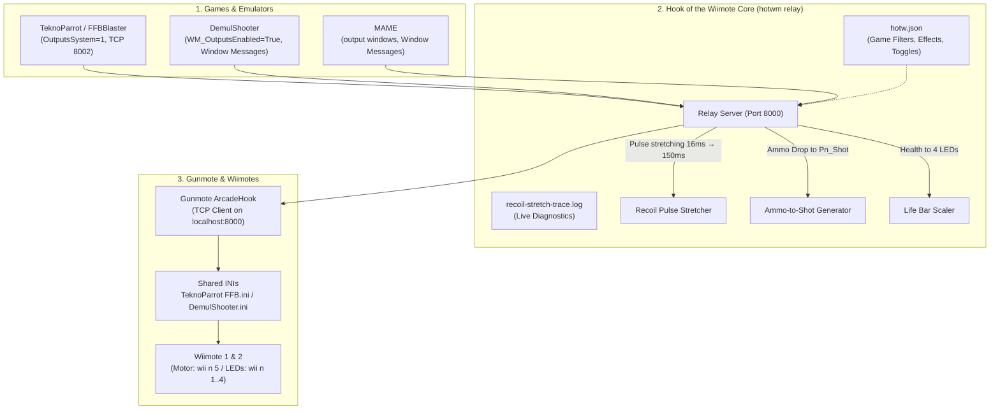

# frieds-hotwm — Hook of the Wiimote 🎯🎮

> **Standalone & Kit-Ready Recoil Rumble & LED Haptics Relay for Gunmote and Wiimotes**

[](LICENSE)
[](https://microsoft.com/windows)
[](https://microsoft.com/powershell)
[](https://python.org)

**English Documentation** | [Deutsche Dokumentation](README.de.md)

> **v0.10.0** · [Download](https://github.com/kburna243/frieds-hotwm/releases/latest) · [Website](https://kburna243.github.io/frieds-hotwm/) · [Changelog](CHANGELOG.md) — needs [Fried's Retrogaming Kit](https://github.com/kburna243/frieds-retrogaming-kit) 1.5+ to save players by Bluetooth address (works standalone without it).

---

## 🎯 About The Project

**Hook of the Wiimote (`hotwm`)** is a beginner-friendly, transparent setup and relay tool for arcade lightgun enthusiasts. It brings full haptic feedback to Wiimotes operated behind **Gunmote**:
- 💥 **Shot and Hit Rumble:** Intelligent pulse stretching (16ms → 150ms) so the Wiimote's mechanical vibration motor has time to spin up and produce a tactile kick.
- 🚦 **Dynamic Health Indicators:** Visualizes player health levels via the 4 Wiimote player LEDs.
- 🔄 **Ammo-Drop to Shot Haptics:** Automatically triggers recoil rumble on ammo decrements for titles lacking explicit force-feedback events.
- 🕹️ **Multi-Platform Support:** Seamless integration with **TeknoParrot / FFBBlaster**, **DemulShooter**, and **MAME**.

Designed both as a **portable standalone tool** for existing RetroBat, TeknoParrot, and MAME installations, and as a first-class module for [*Fried's Retrogaming Kit*](https://github.com/kburna243/frieds-retrogaming-kit).

---

## 🏗️ Architecture



---

## 🖥️ Standalone WPF Dashboard

The native Windows dashboard uses Fried's Night/Cream palette with restrained green, gold, and red status accents. It includes local mascot artwork and runs without web fonts or downloaded visual assets.

- **Guided setup:** Quick, Custom, and Expert modes share the same setup session. Choose a folder, inspect read-only device discovery, and keep a desired Bluetooth MAC-to-player assignment separate from the Gunmote runtime slot observed for the connected controller.
- **Manual hardware checks:** Pairing, calibration, runtime-slot identification, aim, and trigger checks require the user. Windows PnP detection alone does not establish that a controller is paired, calibrated, or playable. “Complete” means all required checks were confirmed by the user; HOTWM does not independently verify hardware function.
- **Reviewed actions:** File changes and task operations are proposed and confirmed one action at a time. Declining a proposal leaves its target unchanged; there is no wizard-wide apply-all.
- **Effect profiles:** Copy a shipped preset into a user profile and edit supported `hotw.json` relay settings: global hold time (80–300 ms), ammo-drop behavior, LED mode, trace flag, and per-game rumble/LED toggles. Imported profiles may also include per-game `hold_ms`; the relay supports it and Apply preserves it, though the per-game editor does not expose that field. Applying shows the edited values and target, makes a backup, and hot-reloads supported settings.
- **Gunmote layout editor:** Edit actual OnScreen/OffScreen button mappings in a layout JSON file and optionally add its filename to `Keymaps.json`. Saving requires review and Gunmote to be closed; it does not activate a layout or restart Gunmote.
- **Button intent profiles:** Record semantic intents such as Shoot or Reload. These notes do not bind a controller or game input.
- **Diagnostics and tests:** Read-only health, device, and Kit status; Player 1/2 rumble and LED test controls; live log monitoring and recoil tuning. Kit diagnostics are not an exact file-change plan for an all-in-one setup, and no external Agent currently consumes the HOTWM snapshot contract.

Launch with `Start-HotwmDashboard.bat` or run `./gui/HotwmDashboard.ps1`.

---

## 🛠️ Quick Start & Setup

### Prerequisites
1. **Windows 10 or 11 (64-Bit)**
2. **Python 3.10+** (in system PATH)
3. **Gunmote** with loaded ArcadeHook DLL
4. **Bluetooth** (integrated or DolphinBar) with paired Wiimotes

### Background Service Installation
To automatically launch the relay on Windows login:
```powershell
.\tools\Install-HotwmTask.ps1
```
To remove the background task:
```powershell
.\tools\Uninstall-HotwmTask.ps1
```

### Building the Standalone Package
To build a portable release ZIP package:
```powershell
.\tools\Build-HotwmPackage.ps1
```
The resulting archive will be placed in `dist/frieds-hotwm-v<version>.zip`.

---

## ⚙️ Configuration (`config/hotw.json`)

```json
{
  "global": {
    "hold_ms": 150,
    "ammo_drop_shot": true,
    "led_mode": "life_bar",
    "trace_enabled": false
  },
  "games": {
    "Rambo": { "rumble": true, "leds": true },
    "2spicy": { "rumble": true, "leds": true },
    "hotd4": { "rumble": true, "leds": true },
    "la_machineguns": { "rumble": true, "leds": false }
  }
}
```

---

## 🚀 Milestones & Status

The original relay, configuration engine, Windows task tools, dashboard foundation, and portable package (Phases 1–5) are completed. Those historical milestones do not mean the newer setup orchestration is finished.

**Current work — guided setup and Kit orchestration:** the dashboard now offers three setup modes, read-only device evidence, manual-check tracking, and individually reviewed local edits. A safe all-in-one Kit flow remains in progress: current Kit dry-runs do not expose the exact file/task proposals HOTWM would need to review and bind to approval. The desired MAC-to-player assignment can be saved in the Kit (Kit API 1.8, "Zuordnung ins Kit übernehmen"): the Kit shows its plan first and writes only that plan. The RetroGamingAgent uses the same Kit operation behind its own approval gate. Real Wiimote operation still requires physical testing.

---

## 📜 License

Software code is MIT licensed — Copyright (c) 2026 Friedrich Börner; see [LICENSE](LICENSE). The packaged Markdown design document is separately licensed under CC BY-SA 4.0 and credited to Friedrich Börner in [docs/design.md](docs/design.md). The accompanying SVG/PNG brand artwork was provided by the project owner; its inclusion does not extend the design document's license to those image assets. Packaged asset provenance is recorded in [docs/brand-assets.md](docs/brand-assets.md).
